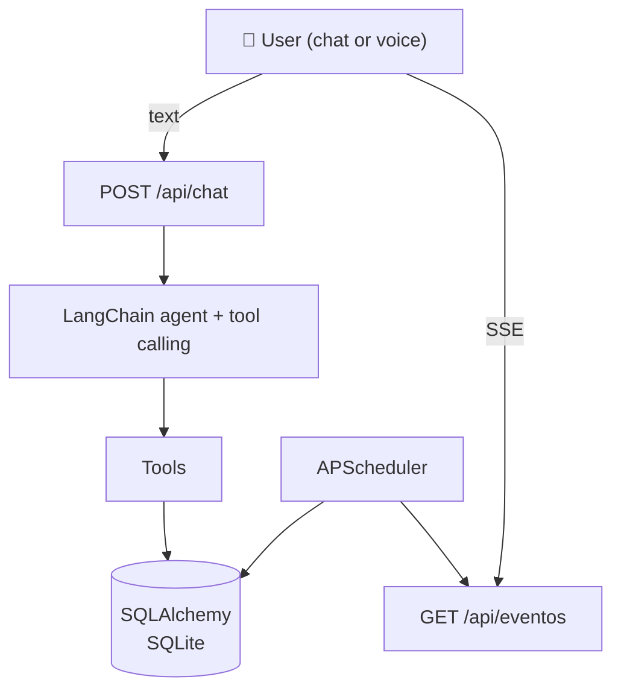

# Trackr

> **Your business, by voice or chat.**

Trackr is a web assistant for small businesses. Instead of clicking through forms, you talk or type to an AI agent that manages inventory, orders, customers, employees, and reminders.

- 💬 **Chat** – type instructions naturally.
- 🎙️ **Voice** *(Phase 2)* – record audio, get a Whisper transcript, confirm, and send.
- ⏰ **Reminders** – manual reminders and automatic low-stock alerts delivered over SSE.
- 📦 **Orders & inventory** – creating or delivering an order updates stock automatically.

**Current status:** Chat and reminders, role-controlled inventory catalog, stock ledger, movement confirmation, and SQLite backups.

---

## What it looks like

| You say / type | Trackr does |
|---|---|
| *"Recuérdame mañana a las 5 llamar al proveedor de empaques"* | Creates a reminder for that user at that time. |
| *"¿Qué recordatorios tengo pendientes?"* | Lists pending reminders. |
| *"¿Cuántas cajas medianas nos quedan?"* | *(Phase 3)* Checks stock. |
| *"El pedido 124 salió por paquetería, guía 998877"* | *(Phase 3)* Marks shipped and deducts stock. |

---

## Architecture



Core rules:

- The agent **never writes SQL**; it only calls tools.
- Agent-proposed writes to orders or inventory require confirmation; administrator/warehouse inventory screen writes use the same validated ledger service.
- Nothing is hard-deleted; state changes keep an audit trail.
- Inventory quantities come from the signed movement ledger; product stock is never stored as a second source of truth.
- Reminders are per-user and delivered only to their SSE channel.
- The scheduler claims due reminders atomically so multiple workers can never fire the same one.

---

## Tech stack

| Layer | Technology |
|---|---|
| Backend | Python 3.11+, FastAPI |
| Agent | LangChain + OpenAI-compatible API (OpenRouter by default) |
| ORM | SQLAlchemy 2.x |
| DB | SQLite |
| Scheduler | APScheduler |
| Frontend | Plain HTML + JavaScript (SSE, MediaRecorder later) |
| Packaging | `uv` |

---

## Project structure

```text
.
├── app/
│   ├── main.py
│   ├── config.py
│   ├── api/                  # auth, chat, SSE, admin, health, inventory
│   ├── agente/
│   │   ├── agente.py
│   │   └── tools/            # reminders, read tools, confirmed writes, executors
│   ├── db/
│   │   ├── base.py
│   │   ├── modelos.py        # Trackr users, sessions, messages, audit
│   │   └── negocio.py        # catalog, orders and inventory ledger
│   ├── servicios/            # roles, stock, movements, backups, scheduler
│   └── static/               # responsive HTML/JS, PWA assets
├── migrations/               # Alembic revisions; SQLite batch mode
├── scripts/                  # user and local-only business seed
├── tests/
├── Dockerfile
├── DEPLOY.md
├── pyproject.toml
└── uv.lock
```

---

## Getting started

Requires [`uv`](https://docs.astral.sh/uv/).

```bash
# 1. Install dependencies
uv sync --group dev

# 2. Configure environment
cp .env.example .env
# Edit .env with your keys

# 3. Create or update the database schema (Alembic; SQLite)
uv run alembic upgrade head

# 4. Create the first user
uv run python -m scripts.crear_usuario --username admin --password "<segura>" --nombre "Administrador" --rol administrador

# 5. Add example business and inventory data (local SQLite file only)
uv run python -m scripts.seed_negocio

# 6. Run the server
uv run uvicorn app.main:app --reload --host 127.0.0.1
```

Open http://localhost:8000, log in, and chat.

Run tests:

```bash
uv run pytest -v
```

---

## Environment variables

| Variable | Default | Purpose |
|---|---|---|
| `OPENAI_API_KEY` | *(required)* | API key for the LLM provider. Also accepts `OPENROUTER_API_KEY`. |
| `OPENAI_BASE_URL` | `https://api.openai.com/v1` | Provider base URL. Also accepts `OPENROUTER_API_BASE_URL`. |
| `MODEL_AGENTE` | `gpt-4o-mini` | Model ID. Use a full ID like `openai/gpt-4o-mini` for OpenRouter. |
| `SECRET_KEY` | *(required)* | Secret for signed session cookies. |
| `DATABASE_URL` | `sqlite:///./dev.db` | SQLAlchemy DB URL. |
| `TIMEZONE` | `America/Monterrey` | Default timezone injected into the agent prompt. |
| `SCHEDULER_INTERVAL_SECONDS` | `10` | How often the scheduler checks due reminders. |
| `CHAT_RATE_LIMIT_PER_MINUTE` | `60` | Per-user chat rate limit. |
| `MEMORIA_MENSAJES_MAX` | `20` | Messages kept in conversational memory. |

---

## API endpoints

| Method | Path | Description |
|---|---|---|
| `POST` | `/api/login` | Log in, sets session cookie. |
| `POST` | `/api/logout` | Clear session. |
| `GET`  | `/api/me` | Current user info. |
| `POST` | `/api/chat` | Send a text message to the agent. |
| `GET`  | `/api/historial` | Get the current user's chat history. |
| `GET`  | `/api/pendiente` | Get current pending write action, if any. |
| `POST` | `/api/confirmar` | Confirm the pending write action. |
| `POST` | `/api/cancelar` | Cancel the pending write action. |
| `GET`  | `/api/eventos` | SSE stream for reminders. |
| `GET` | `/api/inventario/productos` | Active product catalog with role-filtered prices; supports name/category/code search. |
| `GET` | `/api/inventario/resumen` | Stock KPIs and role-filtered inventory values. |
| `GET` | `/api/inventario/catalogos` | Active categories and suppliers. |
| `POST` | `/api/inventario/productos` | Create a product, permitted roles only. |
| `PATCH` | `/api/inventario/productos/{id}` | Edit a product, permitted roles only. |
| `POST` | `/api/inventario/productos/{id}/desactivar` | Admin-only soft delete; preserves history. |
| `GET` | `/api/inventario/movimientos` | Admin/warehouse movement history with filters. |
| `POST` | `/api/inventario/movimientos` | Register permitted stock entries and exits. |

---

## Current data model

### `usuarios`
Employees / users. Hashed passwords, active flag.

### `recordatorios`
| Field | Notes |
|---|---|
| `usuario_id` | Owner; reminders are delivered only to this user. |
| `texto` | Reminder text. |
| `fecha_hora` | UTC internally, shown in the configured business timezone. |
| `estado` | `pendiente` → `vencido` → `visto` (or `cancelado`). |
| `visto_en` | When it was delivered to the UI. |

### `comandos_log`
Audit log of every user command, tool called, arguments, and result.

### `mensajes`
Per-user chat history used by the agent as conversational memory.

### Business tables (`app/db/negocio.py`)

| Table | Purpose |
|---|---|
| `clientes` | Customers. |
| `empleados` | Employees; optionally linked to a Trackr `usuario`. |
| `categorias`, `proveedores` | Product catalog group and one main supplier. |
| `tipos_medidor`, `medidores`, `tamanos`, `tipos_utd` | Product catalogs. |
| `productos` | **One catalog table** for components and finished goods, with optional unique code, category, supplier and MXN prices. `tipo` = `componente` or `terminado`. |
| `recetas` | Bill of materials: components required for a finished product. |
| `pedidos` | Orders with status, delivery type, carrier and tracking number. |
| `pedido_items` | Order lines. |
| `movimientos_inventario` | **Single ledger**; signed quantity and UTC timestamp determine physical stock. New movements store the session user and an idempotency key. |

Dropped from the original schema: `estados`, `componentes`, `equipos`, `equipos_terminados`, `equipos_en_stock`, `detalle_pedido`, `receta_equipo`, `equipo_componentes`, `evidencias`, `carpetas_evidencias`.

### Read tools (via `/api/chat`)

- `consultar_existencia(nombre)` — physical / reserved / available stock for a product.
- `listar_stock_bajo()` — components under minimum and finished products with available stock under minimum.
- `consultar_estado_pedido(texto)` — order status by order number or client name.

---

## Roadmap

### Phase 1 ✅
- [x] Chat endpoint + agent with `crear_recordatorio` and `listar_recordatorios`
- [x] Minimal chat UI with SSE reminder delivery
- [x] SQLite + SQLAlchemy persistence
- [x] Sessions and login
- [x] Atomic scheduler + SSE

### Phase 1.5 *(next)*
- [x] Conversation memory per session
- [x] Confirmation step for inventory/order writes
- [ ] Voice input with Whisper

### Phase 2
- [ ] MySQL support + Alembic migrations
- [ ] Limited DB user permissions

### Phase 3
- [x] Products, customers, employees (read-only tools + models)
- [x] Inventory ledger (`movimientos_inventario`)
- [x] Orders, shipping, and read-only status queries
- [x] Write tools with transactional stock deduction
- [ ] Automatic low-stock alerts

### Phase 4
- [ ] Authentication & roles
- [ ] Richer frontend (React or similar)
- [ ] Audit history UI
- [ ] Production deployment

---

## License


